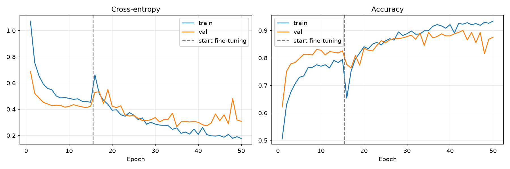

# Wildfire image classifier for the nRF Axon NPU

Train a small image classifier that tells whether a forest scene shows a
wildfire (flames or smoke), quantize it to int8 TFLite, and compile it for the
Axon NPU. The compiled model runs in the `image_classification` application of
sdk-edge-ai on the nRF9251 DK, next to the MLPerf Tiny CIFAR-10 and Visual Wake
Words models.

A typical use case is a cellular, battery-powered camera on a mast that only
reports (or uploads an image) when it sees a fire.

## Approach

| | |
|---|---|
| Dataset | [The Wildfire Dataset](https://www.kaggle.com/datasets/elmadafri/the-wildfire-dataset) (El-Madafri et al., 2023, CC BY 4.0): 2,700 forest images, `fire` / `nofire`, official train/val/test split |
| Model | MobileNetV1, width 0.25, 96×96×3 input (same backbone as MLPerf Tiny VWW), ImageNet weights, global average pooling, 2-class softmax |
| Input | RGB scaled to [-1, 1] (`pixel / 127.5 - 1`), which is what the ImageNet weights expect |
| Output | `no_fire` (0), `fire` (1) |

The dataset is small (1,887 training images), so the network starts from
ImageNet weights and keeps the ImageNet batch norm statistics frozen. It first
trains only the classification head with the backbone frozen, then fine-tunes
the whole network with a cosine learning rate. Training images are cached at
224×224, so random crops keep detail before they are downscaled to 96×96.
Training also adds flips and small brightness, contrast, saturation and hue
changes.

Train and test images go through the same steps the device sees:

* Center-crop to a square, then box-downscale. The UART feeder and the firmware
  downscaler do the same.
* Quantize to RGB565, the wire format of the frames, and expand back to 8 bit.

The model is quantized to int8 after training (post-training quantization),
because the Axon NPU only runs int8 models and the float model (about 860 KB)
does not fit the application flash.

## Results

On the 410 held-out test images (251 no fire, 159 fire):

| Model | Test accuracy | Fire recall | No-fire recall |
|---|---|---|---|
| Keras float | 92.9% | 94.3% | 92.0% |
| int8 TFLite (deployed) | 92.4% | 93.1% | 92.0% |
| Axon compiler simulation | 92.9% | | |

Training curves of the deployed model. The first 15 epochs train only the
classification head with the backbone frozen (dashed line), then the whole
network is fine-tuned. Training stops early when the validation loss no longer
improves, and the weights with the lowest validation loss are kept:



With this little data, results move by a few points between training seeds,
and ±1.5 points is within the noise of a 410-image test set. Choose models on
the validation split, not the test split.

Things that did not help measurably and were removed: knowledge distillation
from an EfficientNetV2-B0 teacher, quantization-aware training, and a 128×128
input.

`analyze_errors.py` saves the misclassified test images as contact sheets.
Missed fires are mostly thin or distant smoke in wide landscapes, plus a few
night scenes. False alarms are mostly fog, low clouds, orange sunsets and snowy
peaks. Some "fire" test images show no visible fire, so part of the remaining
error is label noise.

## Quick start

```bash
./setup_venv.sh    # Python 3.11 venv with training + Axon compiler requirements
./train_all.sh     # dataset, training, int8 quantization, evaluation, Axon compile
```

`setup_venv.sh` and `train_all.sh` take the sdk-edge-ai path as an optional
argument (default `../edge-ai`). On a 16-core CPU without a GPU, training takes
about 2 minutes and the Axon compilation about 1 minute.

Or step by step, with the venv active:

```bash
python prepare_dataset.py   # download with kagglehub (~10 GB), cache 96/224 px arrays
python train.py             # train + fine-tune MobileNetV1 0.25
python quantize.py          # fp32 and full-int8 TFLite
python evaluate.py          # test accuracy and confusion matrix, Keras and int8
python analyze_errors.py    # contact sheets of misclassified test images
./compile_axon.sh           # Axon compile, installs the header in the app
```

The download needs no Kaggle account. If you already have the dataset, pass
`--dataset-dir` to `prepare_dataset.py`.

## Output artifacts

| File | Description |
|------|-------------|
| `data/{train,val,test}_{96,224}.npz` | Cached square RGB images and labels |
| `data/demo/` | 12 held-out test images per class (384×384) to feed to the device |
| `trained_models/wildfire_classifier.keras` | Keras model |
| `trained_models/wildfire_classifier_fp32.tflite` | Float TFLite |
| `trained_models/wildfire_classifier_int8.tflite` | Full-int8 TFLite for Axon |
| `trained_models/training_history.png` | Loss and accuracy curves |
| `trained_models/errors_true_{fire,no_fire}.png` | Misclassified test images |
| `compiler_data/{x,y}_test_wildfire.npy` | Test split for the Axon compiler |
| `outputs/nrf_axon_model_wildfire_.h` | Compiled Axon model, copied to `applications/image_classification/src/generated/` |

## Compiling for Axon

`compile_axon.sh` runs the following steps:

1. `prepare_compiler_data.py` exports the test split as float32 `.npy` files.
2. `axons_tflite_model_scan.py` checks that every operator is supported on Axon.
3. `axons_ml_nn_compiler_executor.py` compiles `compiler_input_yaml_wildfire.yaml`.
   It uses the same settings as the MLPerf Tiny VWW sample (int32 softmax output,
   constants in NVM) and reports the accuracy of the Axon-simulated model on the
   test split.
4. The script installs `outputs/nrf_axon_model_wildfire_.h` in the application.

If the compiled model's `..._MAX_IL_BUFFER_USED` changes after you retrain,
update the `NRF_AXON_INTERLAYER_BUFFER_SIZE` default for
`IMG_CLASS_MODEL_WILDFIRE` in the application's `Kconfig`.

## Running on the nRF9251 DK

From sdk-edge-ai:

```bash
west build -p -b nrf9251dk/nrf9251/cpuapp applications/image_classification -- -DEXTRA_CONF_FILE=wildfire.conf
west flash

python3 applications/image_classification/scripts/feed_images_uart.py --model wildfire \
  --port /dev/serial/by-id/usb-SEGGER_J-Link_<serial>-if02 --interval 10 --shuffle --loop \
  ../wildfire_axon/data/demo/
```

The device console (VCOM0) logs `Class 1: FIRE (99.5%)` or `Class 0: NO_FIRE (...)` for each frame.

## Tuning

Edit `config.yaml` to change:

* the input size (also change `MODEL_WIDTH`/`MODEL_HEIGHT` in the firmware),
* the width multiplier `alpha`,
* dropout, epochs and learning rates,
* the number of calibration samples used for int8 quantization.
